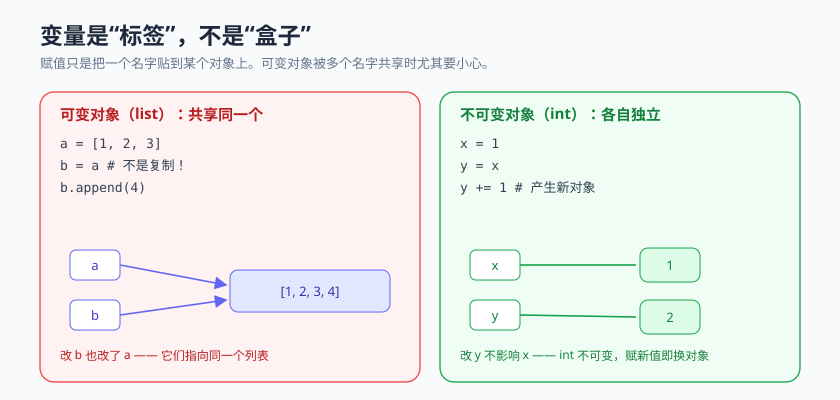

# 模块 1 · Python 语言精要

> 统一结构：概念心智模型 → 最小可运行示例 → 常见坑 → 和 AI 这样协作 → 本周任务

## 概念心智模型



Python 的设计哲学可以浓缩成几条，理解它们比记语法更重要：

1. **一切皆对象**：数字、函数、类本身都是对象，都能被传递和赋值。
2. **数据模型统一行为**：很多"内置语法"（如 `len(x)`、`for x in y`）背后是对象实现了对应的"魔术方法"（`__len__`、`__iter__`）。理解这点，你就能读懂库是怎么"变魔术"的。
3. **鸭子类型**：Python 不太care"你是什么类型"，只care"你会不会做这件事"。
4. **可变 vs 不可变**：这是最容易踩坑的点。`list`/`dict` 可变，`int`/`str`/`tuple` 不可变——它直接影响函数传参、默认参数、拷贝行为。
5. **异常是正常控制流的一部分**：Python 鼓励"先做、出错再处理"（EAFP），而不是"先层层检查"（LBYL）。

## 最小可运行示例

```python
# 推导式：简洁地构造数据
nums = [1, 2, 3, 4, 5]
squares = [n * n for n in nums]              # [1, 4, 9, 16, 25]
evens = {n for n in nums if n % 2 == 0}      # {2, 4}
name_len = {w: len(w) for w in ["a", "bb"]}  # {'a': 1, 'bb': 2}

# 异常处理（EAFP 风格）
def safe_div(a, b):
    try:
        return a / b
    except ZeroDivisionError:
        return None

# 鸭子类型：只要能迭代就行，不关心具体类型
def total(items):
    return sum(items)

print(total([1, 2, 3]))        # 列表
print(total((1, 2, 3)))        # 元组
print(total(range(4)))         # range 对象
```

## 常见坑

- **可变默认参数**：`def f(x, acc=[])` —— 默认的 `[]` 只创建一次，会在多次调用间共享！应写成 `acc=None` 再在函数内 `acc = acc or []`。
- **`is` 与 `==` 混用**：`==` 比较值，`is` 比较"是不是同一个对象"。判断值相等用 `==`。
- **浅拷贝 vs 深拷贝**：`b = a` 只是起了个别名；改 `b` 会影响 `a`（当它是可变对象时）。
- **循环里修改正在遍历的列表**：会产生难以预料的行为。
- **误以为字符串可变**：字符串不可变，拼接大量字符串用 `"".join(...)` 而非 `+=`。

## 和 AI 这样协作

本周重点练习：**让 AI 写小脚本，然后你逐行读懂、改写。**

- 让 AI 生成一个 20 行左右的脚本后，关掉 AI，自己口头解释每一行。解释不出来的行，就是你要补的知识点。
- 故意让 AI 写一个"有可变默认参数坑"的函数，看你能否一眼发现。
- 让 AI 把一段 `for` 循环改写成推导式，判断改写后**可读性是更好还是更差**——不是越简洁越好。

## 本周任务

1. 给贯穿项目写一个 S0 版本：命令行小脚本，用内存 list 存任务，支持"添加 / 列出 / 标记完成"。
2. 其中至少用到：推导式、异常处理、一个自定义函数。
3. 找出并避免"可变默认参数"坑（在协作记录里说明你怎么发现的）。
4. 附协作记录（见 [检查清单](../_shared/ai-collaboration-checklist.md)）。
