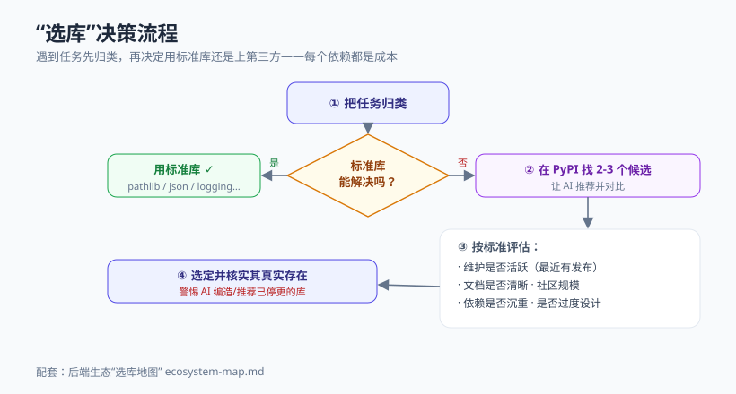

# 模块 3 · 标准库与生态地图

> 统一结构：概念心智模型 → 最小可运行示例 → 常见坑 → 和 AI 这样协作 → 本周任务

## 概念心智模型



- **先问标准库**：Python "自带电池"，大量需求（路径、时间、JSON、日志、随机、计数）标准库已经解决，不必装第三方。每一个依赖都是维护成本和安全风险。
- **PyPI 是第三方世界**：确实需要时，从 PyPI 用 `uv add` / `pip install` 装。但要克制。
- **"选库"是一项核心工程能力**：遇到任务先归类（这属于哪一类问题？），再在候选里按"维护活跃度 / 文档 / 依赖重量 / 社区规模"取舍。详见 [生态地图](../_shared/ecosystem-map.md)。
- **心智索引**：你不需要背每个库的 API，但要在脑子里有一张"什么任务→哪类工具"的地图。缺的细节交给 AI 和文档。

## 最小可运行示例

```python
from pathlib import Path
import json
import logging
from datetime import datetime, timezone
from collections import Counter
import secrets

# 配置结构化日志（生产可换 structlog，但先会用标准库）
logging.basicConfig(
    level=logging.INFO,
    format="%(asctime)s %(levelname)s %(name)s: %(message)s",
)
logger = logging.getLogger("tasks")

# 1. pathlib：别再用字符串拼路径
data_dir = Path(__file__).parent / "data"
data_dir.mkdir(exist_ok=True)
data_file = data_dir / "tasks.json"

# 2. json：读写数据
def save_tasks(tasks: list[dict]) -> None:
    data_file.write_text(
        json.dumps(tasks, ensure_ascii=False, indent=2),
        encoding="utf-8",
    )
    logger.info("已保存 %d 条任务到 %s", len(tasks), data_file)

def load_tasks() -> list[dict]:
    if not data_file.exists():
        return []
    return json.loads(data_file.read_text(encoding="utf-8"))

# 3. datetime：带时区的时间戳（避免"天真时间"坑）
now = datetime.now(timezone.utc).isoformat()

# 4. secrets：生成安全随机 token（绝不用 random 做安全相关）
api_token = secrets.token_urlsafe(16)

# 5. collections.Counter：统计标签
def tag_stats(tasks: list[dict]) -> dict[str, int]:
    all_tags = [tag for t in tasks for tag in t.get("tags", [])]
    return dict(Counter(all_tags))

if __name__ == "__main__":
    tasks = [{"title": "a", "tags": ["x", "y"]}, {"title": "b", "tags": ["x"]}]
    save_tasks(tasks)
    print("加载：", load_tasks())
    print("时间：", now)
    print("token：", api_token)
    print("标签统计：", tag_stats(tasks))
```

## 常见坑

- **为小功能引入重型库**：为了格式化一个日期就装个大库——标准库 `datetime` 就够了。
- **用 `random` 做安全**：`random` 不是密码学安全的。生成 token/密钥用 `secrets`。
- **手动拼路径字符串**：`dir + "/" + name` 跨平台会出问题，且易错。用 `pathlib` 的 `/` 运算符。
- **"天真时间"（naive datetime）**：不带时区的时间在跨时区场景会算错。存储/传输统一用 UTC + ISO 格式。
- **没有日志**：出问题只能靠 `print` 猜。从一开始就用 `logging`。
- **AI 推荐了不存在/已停更的库**：务必核实（见下）。

## 和 AI 这样协作

- 做一次**"选库练习"**：给 AI 一个具体需求（例如"定时清理过期任务"），让它**推荐 3 个候选方案并逐项对比**（适用场景、依赖、维护度）。你用 [生态地图](../_shared/ecosystem-map.md) 的标准核验它的结论。
- **核实真实性**：AI 有时会编造看似合理的库名或 API。推荐的库先到 PyPI / 官方文档确认存在、确认维护活跃，再用。
- 让 AI 在"标准库能做 vs 上第三方"之间给建议，并要求它说明为什么。

## 本周任务

1. 给贯穿项目加"数据持久化到 JSON 文件"的能力（只用标准库 `pathlib` + `json`），并接入 `logging`。
2. 加一个"标签统计"功能，用 `collections.Counter`。
3. 完成一次选库练习：为一个新需求写一份候选库对比表。
4. 附协作记录，特别说明你如何核实 AI 推荐的库是否可靠（见 [检查清单](../_shared/ai-collaboration-checklist.md)）。
