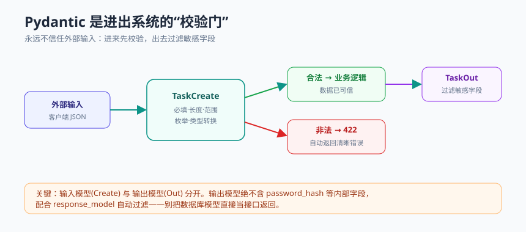

# 模块 5 · 数据校验与建模

> 统一结构：概念心智模型 → 最小可运行示例 → 常见坑 → 和 AI 这样协作 → 本周任务

## 概念心智模型



- **永远不要信任外部输入**：来自客户端的一切数据都可能是错的、恶意的。在进入业务逻辑前必须校验。
- **类型驱动开发**：用 Pydantic 模型声明"数据应该长什么样"，校验、类型转换、错误信息、API 文档就都自动来了。你描述"形状"，库负责"把关"。
- **输入模型 ≠ 输出模型**：接收的数据（`TaskCreate`，含用户填的字段）和返回的数据（`TaskOut`，含 id、时间戳，但不含密码等敏感字段）通常不同。分开建模。
- **校验集中在边界**：所有校验逻辑收敛到 schema 层，而不是散落在每个函数里。
- **FastAPI + Pydantic**：函数签名里声明 Pydantic 模型，校验失败 FastAPI 自动返回 422 和清晰的错误详情。

## 最小可运行示例

```python
# app/schemas.py
from datetime import datetime
from enum import Enum
from pydantic import BaseModel, Field, field_validator


class Priority(str, Enum):
    low = "low"
    medium = "medium"
    high = "high"


# 输入模型：客户端创建任务时提交的字段
class TaskCreate(BaseModel):
    title: str = Field(min_length=1, max_length=100)
    priority: Priority = Priority.medium
    tags: list[str] = Field(default_factory=list, max_length=10)

    @field_validator("tags")
    @classmethod
    def strip_tags(cls, v: list[str]) -> list[str]:
        cleaned = [t.strip() for t in v if t.strip()]
        return cleaned


# 输出模型：返回给客户端的字段（含 id/时间戳；绝不含内部/敏感字段）
class TaskOut(BaseModel):
    id: int
    title: str
    priority: Priority
    tags: list[str]
    done: bool
    created_at: datetime
```

```python
# app/main.py 片段
from fastapi import FastAPI, status
from .schemas import TaskCreate, TaskOut

app = FastAPI()

@app.post("/tasks", response_model=TaskOut, status_code=status.HTTP_201_CREATED)
def create_task(payload: TaskCreate):
    # payload 到这里已经被校验过：title 非空且 <=100、priority 合法、tags 清洗过
    record = {
        "id": 1, "done": False, "created_at": "2026-01-01T00:00:00",
        **payload.model_dump(),
    }
    return record  # response_model=TaskOut 会过滤掉多余字段，保证输出形状
```

发一个 `{"title": ""}` 过去，会自动得到 422 和"title 太短"的说明——你一行校验代码都不用手写。

## 常见坑

- **把数据库模型直接当接口返回**：极易泄露 `password_hash`、内部状态等敏感字段。永远用独立的输出模型（配 `response_model`）。
- **校验逻辑散落各处**：今天在这个函数判空、明天在那个函数判长度，难维护、易漏。集中到 schema。
- **可选字段与默认值混淆**：`Optional[str]`（可以不传）和"必填但可为空"是两回事，要想清楚。
- **过度信任客户端传的 id / 时间戳**：这些应由服务端生成，别让客户端决定。
- **Pydantic v1 / v2 API 混用**：AI 常给过时的 v1 写法（如 `.dict()` 而非 `.model_dump()`）。确认版本。

## 和 AI 这样协作

- 让 AI 根据你的需求设计 Pydantic 模型，你重点审查三点：**约束是否完整**（长度、范围、必填）、**是否区分了输入/输出模型**、**输出模型有没有泄露敏感字段**。
- **主动攻击自己的接口**：发空值、超长字符串、非法枚举、缺字段，确认校验真的拦住了。
- 注意 AI 可能给 Pydantic v1 的旧写法，本课用 v2，发现后让它改正。

## 本周任务

1. 贯穿项目 S2：为 Task 和 Bookmark 定义输入模型（`*Create`）与输出模型（`*Out`），加字段约束。
2. 确保服务端生成的字段（id、created_at）不由客户端决定，敏感字段不出现在输出。
3. 用至少 5 组非法输入测试校验是否生效，记录结果。
4. 附协作记录（见 [检查清单](../_shared/ai-collaboration-checklist.md)）。
