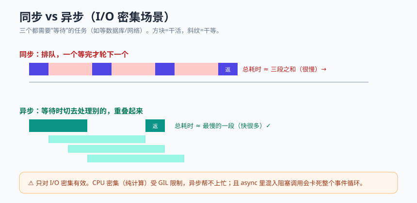

# 模块 7 · 异步编程

> 统一结构：概念心智模型 → 最小可运行示例 → 常见坑 → 和 AI 这样协作 → 本周任务

## 概念心智模型



- **同步 = 排队干等；异步 = 发起后不干等，趁等待的空档去做别的事。** 异步擅长 **I/O 密集**场景：等数据库、等网络请求、等文件——这些等待时 CPU 本来是闲着的。
- **`async def` 定义协程，`await` 等待它完成**。`await` 处就是"可以切出去做别的事"的让渡点。
- **事件循环**：背后有个调度器，在众多协程的 `await` 让渡点之间来回切换，制造"同时在处理很多请求"的效果。
- **并发 ≠ 并行**：异步是**单线程内的并发**（快速交替），不是多核同时跑。所以 **CPU 密集**任务（大量计算）异步帮不上忙——那受 GIL 限制，需要多进程等手段。
- **一颗老鼠屎坏一锅汤**：在 async 函数里调用一个**阻塞**调用（同步 I/O、`time.sleep`、重计算），会卡死整个事件循环，所有请求一起等。

## 最小可运行示例

```python
import asyncio
import httpx  # 异步 HTTP 客户端（同步版是 requests，别在 async 里用它）


async def fetch_title(client: httpx.AsyncClient, url: str) -> int:
    resp = await client.get(url)       # await 处让渡，去处理别的请求
    return len(resp.text)


async def main():
    urls = ["https://example.com"] * 5
    async with httpx.AsyncClient(timeout=10) as client:
        # 并发发起 5 个请求：总耗时≈最慢的一个，而非 5 个相加
        tasks = [fetch_title(client, u) for u in urls]
        sizes = await asyncio.gather(*tasks)
        print("各页面大小：", sizes)


if __name__ == "__main__":
    asyncio.run(main())
```

FastAPI 里，把端点写成 `async def` 即可，框架自动在事件循环里调度：

```python
@app.get("/external")
async def call_external():
    async with httpx.AsyncClient() as client:
        resp = await client.get("https://example.com")
    return {"size": len(resp.text)}
```

## 常见坑

- **在异步代码里做阻塞调用**：用同步 `requests`、`time.sleep(5)`、或一段重计算——会冻结事件循环。异步 I/O 用 `httpx`/异步驱动；非得跑阻塞代码用 `run_in_executor` 丢到线程池；睡眠用 `await asyncio.sleep`。
- **以为异步能加速计算**：CPU 密集任务改成 async 不会变快，反而增加复杂度。
- **忘了 `await`**：`resp = client.get(url)` 少写 await，拿到的是协程对象不是结果，后续全错。
- **过度异步化**：简单的、无并发压力的脚本/端点，同步代码更直白、更好调试。不要为异步而异步。
- **混用同步/异步数据库会话**：异步端点要配异步数据库驱动与会话，别混。

## 和 AI 这样协作

- 让 AI 把一个同步端点改成异步后，先问自己也问它：**这里真的需要异步吗？**（有没有真实的 I/O 等待与并发压力）别被"异步显得高级"带偏。
- 审查改动时专盯**残留的阻塞调用**：`requests`、`time.sleep`、同步数据库调用藏在 async 函数里——这是最常见也最隐蔽的坑。
- 让 AI 解释："这个 `await` 在等什么？事件循环此刻可以去做什么？"

## 本周任务

1. 贯穿项目 S4：把一个真正 I/O 密集的端点改为 `async`（如调用外部接口、或接入异步数据库驱动）。
2. 用 `httpx` + `asyncio.gather` 做一次并发请求，对比并发 vs 串行的耗时。
3. 排查并消除任何残留的阻塞调用。
4. 附协作记录，说明你为什么判断这些地方"值得/不值得"异步化（见 [检查清单](../_shared/ai-collaboration-checklist.md)）。
