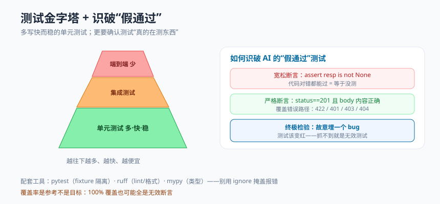

# 模块 9 · 测试与质量

> 统一结构：概念心智模型 → 最小可运行示例 → 常见坑 → 和 AI 这样协作 → 本周任务
> 本模块训练一项关键判断力：识别"假通过"的测试。

## 概念心智模型



- **测试是给未来的你和 AI 的安全网**：有了测试，你改代码（或让 AI 改）后能立刻知道有没有改坏。没有测试，重构就是在走钢丝。
- **测行为，别测实现**：好测试关注"给定输入→得到什么输出/状态变化"，而非内部怎么实现。否则一重构测试就红，但其实没 bug。
- **夹具（fixture）**：pytest 用来为测试准备/清理环境（临时数据库、测试客户端）的机制，让每个测试在干净独立的状态下跑。
- **边界与错误路径才是重点**：空输入、超长、非法值、未授权、找不到——bug 大多藏在这里，而不是"快乐路径"。
- **静态检查前置拦错**：ruff（lint + 格式化）、mypy（类型）在代码运行前就能抓一类错误，又快又省事。
- **覆盖率是参考不是目标**：100% 覆盖率也可能全是无效断言。覆盖率高 ≠ 没 bug。

## 最小可运行示例

```python
# tests/conftest.py —— 用内存 SQLite + 测试客户端做隔离
import pytest
from fastapi.testclient import TestClient
from sqlalchemy import create_engine
from sqlalchemy.orm import sessionmaker
from app.main import app, get_db
from app.database import Base

@pytest.fixture()
def client():
    engine = create_engine("sqlite:///:memory:",
                           connect_args={"check_same_thread": False})
    TestingSession = sessionmaker(bind=engine)
    Base.metadata.create_all(engine)

    def override_get_db():
        db = TestingSession()
        try:
            yield db
        finally:
            db.close()

    app.dependency_overrides[get_db] = override_get_db
    yield TestClient(app)
    app.dependency_overrides.clear()
```

```python
# tests/test_tasks.py
def test_create_task_returns_201(client):
    resp = client.post("/tasks", json={"title": "写测试"})
    assert resp.status_code == 201
    body = resp.json()
    assert body["title"] == "写测试"
    assert body["done"] is False
    assert "id" in body

def test_empty_title_is_rejected(client):   # 错误路径：空标题应被校验拦下
    resp = client.post("/tasks", json={"title": ""})
    assert resp.status_code == 422

def test_get_missing_task_returns_404(client):  # 边界：不存在的资源
    assert client.get("/tasks/99999").status_code == 404
```

运行：`uv run pytest -v`。质量检查：`uv run ruff check .`、`uv run mypy app`。

## 常见坑

- **测试依赖真实外部服务/生产库**：测试应隔离、可重复。用内存库、mock 外部调用。
- **只测快乐路径**：只测"正常创建成功"，不测空值、越权、404——而 bug 恰恰在那。
- **AI 写的"假通过"测试**：断言太宽松（只 `assert resp.status_code` 不看内容，或 `assert result is not None`），代码对不对都能过——等于没测。**这是本模块要重点识破的。**
- **测试之间互相依赖**：测试 B 依赖测试 A 先跑过、或共享可变状态，换个顺序就崩。每个测试应独立自足。
- **把 mypy/ruff 的报错全 `# type: ignore` / `# noqa` 掩盖掉**：那是掩耳盗铃。

## 和 AI 这样协作（关键判断力训练）

- 让 AI 为端点写测试后，逐条判断：**每个断言是真的在验证行为，还是只是摆样子？** 宽松到"怎么写都过"的断言要加严。
- **用"埋 bug"验证测试有效性**：故意在业务代码里改错一行（比如创建时不设默认值、授权判断反了），重跑测试——**抓不到的测试就是无效测试**。这是检验测试质量最硬的办法。
- 让 AI 补齐错误路径与边界用例，而不只是快乐路径。

## 本周任务

1. 贯穿项目 S6：为关键端点写 pytest 测试，覆盖创建、查询、**校验失败(422)、未授权(401/403)、找不到(404)** 等路径。
2. 做一次"埋 bug"练习，证明你的测试能抓到它。
3. 接入 ruff + mypy 并修掉报告的问题（不许用 ignore 掩盖）。
4. 附协作记录，说明你如何判断并加严了 AI 的"假通过"测试（见 [检查清单](../_shared/ai-collaboration-checklist.md)）。
